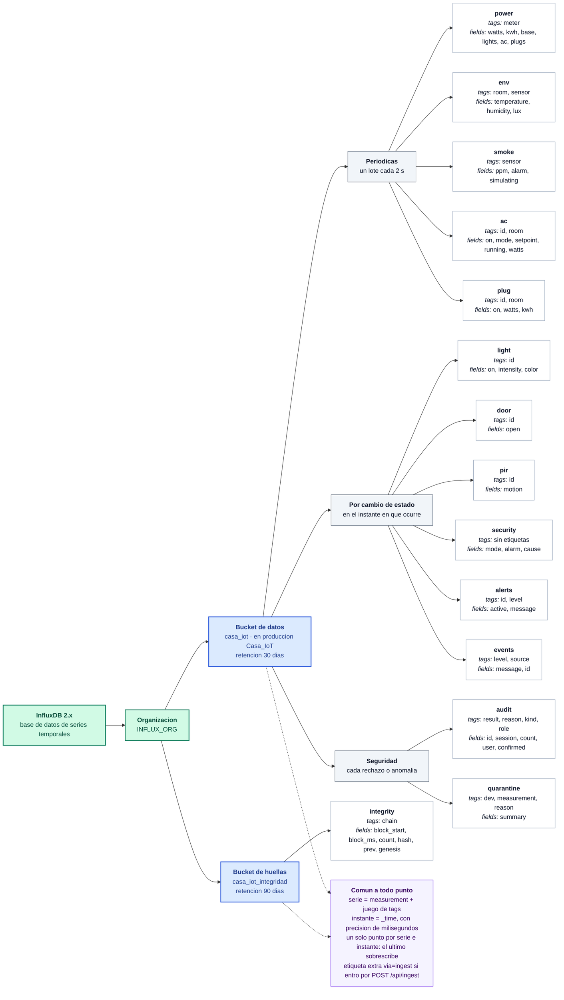
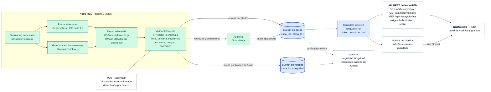

# Modelo de datos en InfluxDB

**En una frase:** como se organiza lo que SmartHouse3D guarda en InfluxDB 2.x, que es una base de datos de **series temporales**, no relacional: no hay tablas ni claves foraneas, sino mediciones con etiquetas, valores y una marca de tiempo.

Todo lo que aparece aqui esta leido del codigo del proyecto. Al final de cada seccion se indica el archivo exacto. Los datos los **genera Node-RED**: la casa es una simulacion y no hay sensores fisicos.

Los diagramas en Mermaid estan en [`docs/diagramas/`](diagramas/) y se pueden abrir tambien en <https://mermaid.live> para exportarlos como imagen.

---

## 1. Estructura de almacenamiento

> Fuente del diagrama: [`docs/diagramas/influxdb-estructura.mmd`](diagramas/influxdb-estructura.mmd)



### Que significa cada nivel

| Nivel | Que es | En este proyecto |
|---|---|---|
| **InfluxDB 2.x** | El motor de base de datos. Guarda medidas acompanadas de su hora exacta. | En produccion es InfluxDB Cloud (`us-east-1`); en local, InfluxDB 2.7 en Docker o instalado. |
| **Organizacion** | El espacio de trabajo dentro de InfluxDB, al que pertenecen los buckets y los tokens. | Variable `INFLUX_ORG`. Su valor **no esta en el repositorio**: se define en el entorno. Por defecto el generador usa `casa`. |
| **Bucket** | El contenedor de datos, con su propio tiempo de retencion. Equivale, de lejos, a una base de datos. | Dos, a proposito separados: uno con los datos de la casa y otro solo con las huellas de integridad, para que el token que escribe datos no pueda tocar las huellas. |
| **Measurement** | El nombre de lo que se mide. Es lo mas parecido a una tabla, pero sin esquema fijo impuesto por el motor. | 14 en total: 13 en el bucket de datos y 1 en el de huellas. |
| **Tag** | Etiqueta **de texto** que clasifica el punto. Va indexada, asi que es por donde conviene filtrar (habitacion, dispositivo, sensor). | Por ejemplo `room`, `id`, `sensor`, `meter`, `level`. |
| **Field** | El **valor** que se guarda. No esta indexado: es el dato en si (un numero, un booleano o un texto). | Por ejemplo `temperature`, `watts`, `on`, `message`. |
| **Timestamp** | El instante del punto, la columna `_time`. | Node-RED lo pone explicitamente en cada punto y escribe con **precision de milisegundos**. |

La diferencia entre tag y field es la que mas se confunde: **se filtra por tags y se grafica por fields**. En `env`, la habitacion (`room`) es un tag porque sirve para elegir que serie mirar, mientras que la temperatura (`temperature`) es un field porque es el numero que se dibuja.

Una **serie** es la combinacion de measurement mas el juego completo de tags. InfluxDB guarda un unico punto por serie e instante: si llegaran dos con la misma marca de tiempo, el segundo sobrescribe al primero.

### Mediciones, una por una

**Periodicas** &mdash; Node-RED arma un lote con todas cada 2 segundos (`cfg.INFLUX.persistEverySec`).

| Measurement | Tags | Fields | Nota |
|---|---|---|---|
| `power` | `meter` | `watts`, `kwh`, `base`, `lights`, `ac`, `plugs` | Un solo medidor general. `base`, `lights`, `ac` y `plugs` son el desglose del consumo. |
| `env` | `room`, `sensor` | `temperature`, `humidity`, `lux` | Una serie por habitacion. El punto con `room = exterior` trae **solo** `temperature`. |
| `smoke` | `sensor` | `ppm`, `alarm`, `simulating` | Un unico sensor de humo. `simulating` indica que la fuga esta forzada desde la interfaz. |
| `ac` | `id`, `room` | `on`, `mode`, `setpoint`, `running`, `watts` | `mode` solo admite `cool` o `fan`. `running` es si el compresor esta trabajando. |
| `plug` | `id`, `room` | `on`, `watts`, `kwh` | Un tomacorriente por serie, con su propio acumulado. |

**Por cambio de estado** &mdash; se escriben en el momento exacto en que ocurre el cambio, no cada 2 segundos.

| Measurement | Tags | Fields | Nota |
|---|---|---|---|
| `light` | `id` | `on`, `intensity`, `color` | `color` es un hexadecimal `#rrggbb`. |
| `door` | `id` | `open` | |
| `pir` | `id` | `motion` | Sensores de movimiento. |
| `security` | *(ninguno)* | `mode`, `alarm`, `cause` | **Sin tags**: hay una sola alarma en la casa. `mode` es `disarmed`, `home` o `away`. |
| `alerts` | `id`, `level` | `active`, `message` | |
| `events` | `level`, `source` | `message`, `id` | El registro de eventos que se ve en la interfaz. |

**Seguridad** &mdash; las escribe la auditoria, con un tope de puntos por segundo para que una inundacion no llene la base de datos.

| Measurement | Tags | Fields | Nota |
|---|---|---|---|
| `audit` | `result`, `reason`, `kind`, `role` | `id`, `session`, `count`, y `user` y `confirmed` cuando aplican | Nunca guarda claves ni firmas. `session` es un resumen de 8 caracteres y `user` el alias de quien emparejo. |
| `quarantine` | `dev`, `measurement`, `reason` | `summary` | Lecturas fisicamente imposibles, apartadas para no contaminar el historial. |

**Huellas de integridad** &mdash; en el **otro** bucket.

| Measurement | Tags | Fields | Nota |
|---|---|---|---|
| `integrity` | `chain` | `block_start`, `block_ms`, `count`, `hash`, `prev`, `genesis` | Un punto por bloque de 5 minutos. Cada huella incluye la anterior, formando una cadena: si alguien borra o altera puntos, deja de cuadrar. |

> De donde sale cada cosa: las periodicas de [`infra/nodered/src/95-persistir.js`](../infra/nodered/src/95-persistir.js); las de cambio de estado de [`96-eventos-influx.js`](../infra/nodered/src/96-eventos-influx.js); `audit` y `quarantine` de [`08-auditar.js`](../infra/nodered/src/08-auditar.js); `integrity` de [`87-validar-telemetria.js`](../infra/nodered/src/87-validar-telemetria.js). Los tags y fields que se aceptan, con su tipo y su rango, estan declarados en el `schema` de [`infra/nodered/tools/security-policy.mts`](../infra/nodered/tools/security-policy.mts). Los nombres de los buckets y la organizacion, en [`infra/nodered/tools/build-flows.mts`](../infra/nodered/tools/build-flows.mts); la retencion, en [`infra/aplicar-retencion.mjs`](../infra/aplicar-retencion.mjs).

---

## 2. Recorrido del dato

> Fuente del diagrama: [`docs/diagramas/influxdb-flujo.mmd`](diagramas/influxdb-flujo.mmd)



De izquierda a derecha: Node-RED simula la casa, arma los puntos, los **firma** uno a uno y los **valida** antes de escribir. Ese validador es la unica puerta de entrada a la base de datos: lo que no pasa la firma, la ventana de tiempo, el numero de secuencia, el esquema o los rangos, no entra, y las lecturas imposibles van a cuarentena. Despues, la interfaz **no** consulta InfluxDB directamente: pide el historial a la API de Node-RED, que traduce la peticion a Flux con un token de solo lectura.

### Las consultas que existen

| Endpoint | Measurement y fields que lee | Agregacion |
|---|---|---|
| `GET /api/history/power` | `power`: `watts`, `base`, `lights`, `ac`, `plugs` | `aggregateWindow(fn: mean)` y `pivot` por `_time` |
| `GET /api/history/smoke` | `smoke`: `ppm` | `aggregateWindow(fn: max)` |
| `GET /api/history/climate` | `env`: `temperature`, filtrando `room` y `exterior` | `aggregateWindow(fn: mean)` |
| Monitor del pipeline | `power`: `watts`, ultimos 10 minutos | `aggregateWindow(fn: count)` y ultimo punto |

Los tres endpoints de historial exigen `Authorization: Bearer <clave>`; el monitor lo consulta Node-RED por su cuenta y manda el resultado por WebSocket.

> De donde sale: [`98-hist-power.js`](../infra/nodered/src/98-hist-power.js), [`98-hist-smoke.js`](../infra/nodered/src/98-hist-smoke.js), [`98-hist-clima.js`](../infra/nodered/src/98-hist-clima.js), [`88-pipeline-contar.js`](../infra/nodered/src/88-pipeline-contar.js) y [`88-pipeline-ultimo.js`](../infra/nodered/src/88-pipeline-ultimo.js). El cableado de los nodos, en [`build-flows.mts`](../infra/nodered/tools/build-flows.mts).

---

## 3. Lo que no esta configurado

Para que el modelo quede honesto, esto **no** existe en el proyecto y por eso no aparece en los diagramas:

- **No hay tareas de InfluxDB** (*tasks*) ni *downsampling* almacenado. Todo el resumen de datos se hace en la consulta, con `aggregateWindow`, no en una tarea programada dentro de la base de datos.
- **No hay tablas ni relaciones.** InfluxDB 2.x no es relacional: no existen claves primarias, claves foraneas ni *joins* entre mediciones. La relacion entre un aire acondicionado y su habitacion se expresa con los tags `id` y `room` del propio punto, no con una tabla aparte.
- **El valor de `INFLUX_ORG` no esta en el repositorio.** Se define en el entorno (panel de Render en produccion, `infra/.env` en local). El generador del flujo usa `casa` solo como valor por defecto.
- **Los tokens tampoco estan en el repositorio.** Son dos, de un solo permiso cada uno: uno escribe y otro lee. El flujo guarda unicamente referencias `${INFLUX_TOKEN_WRITE}` y `${INFLUX_TOKEN_READ}`.
- **La medicion `events` guarda el texto del evento**, pero no es un registro de auditoria: esa funcion la cumple `audit`, que es independiente.

---

## 4. Regenerar o exportar los diagramas

Los archivos `.mmd` son texto plano y se pueden editar a mano. Para obtener una imagen:

1. Abrir <https://mermaid.live>, pegar el contenido del `.mmd` y exportar como PNG o SVG.
2. O instalar la herramienta de linea de comandos y renderizar:

```bash
npx -y @mermaid-js/mermaid-cli -i docs/diagramas/influxdb-estructura.mmd -o docs/diagramas/influxdb-estructura.png -b white -s 2
```

GitHub y VS Code (con la extension de Mermaid) dibujan los diagramas de este documento sin instalar nada.
