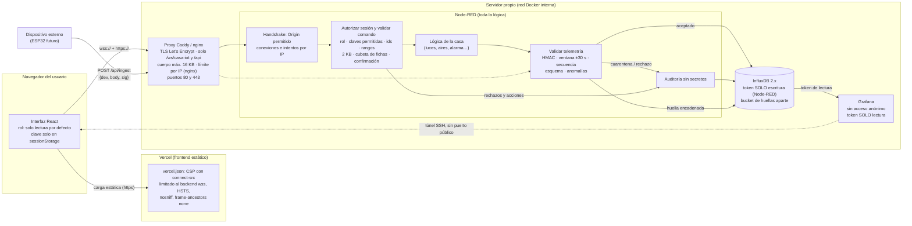

# Seguridad IoT del gemelo digital · plan, medidas y evidencia

> **Casa IoT · Gemelo digital (SmartHouse 3D)** — Wilder Gutiérrez Molina · Jhojan Brausin
> Este documento describe lo que **se encontró** en el proyecto original, lo que **se cambió** para hacerlo más seguro y lo que
> **todavía no está probado**. Está escrito para entenderse sin haber visto el código.

**Cómo leerlo:** cada medida está atada a uno de dos riesgos y a un objetivo de seguridad (C = confidencialidad, I = integridad,
D = disponibilidad):

| Riesgo | Qué significa aquí |
|---|---|
| **R1** | Control no autorizado: alguien que **no debería** manda una orden (abrir una puerta, desarmar la alarma) porque el canal no verifica quién la envía. |
| **R2** | Exposición o almacenamiento inseguro de **credenciales y servicios**: tokens en el repositorio, puertos abiertos, paneles sin contraseña. |

**Alcance:** datos en tránsito e integridad de lo que se manda y se guarda. **No** hay registro de cuentas ni recuperación de
contraseña. La identidad que se verifica es la del **dispositivo** y la de la **sesión** (la pantalla emparejada); si la sesión se empareja
con una **clave personal** (`CASA_USERS`), también el **alias** de esa persona, que queda en la auditoría. Los roles Administrador / Operador / Lector del taller se convirtieron en **capacidades del canal** (qué tipo de mensaje puede
enviar cada sesión). Toda la lógica vive en Node-RED; React solo muestra y envía órdenes.

---

## 1. Resumen

- **Antes:** cualquiera que alcanzara el WebSocket podía mandar órdenes; el token de InfluxDB estaba en texto plano en el repositorio; se
  publicaban los puertos de Node-RED, InfluxDB y Grafana con contraseñas por defecto (credenciales `[REDACTADO]` de Grafana e InfluxDB); el editor de Node-RED no pedía
  contraseña; la API respondía `Access-Control-Allow-Origin: *`; había un adaptador MQTT directo desde el navegador que se saltaba toda
  validación; no había TLS, ni cabeceras de seguridad, ni auditoría.
- **Ahora:** toda conexión nueva es de **solo lectura**; para dar órdenes hay que emparejar la pantalla con una clave; Node-RED valida **cada**
  orden (rol, forma, ids, rangos), pide **confirmación con código de un solo uso** para las acciones sensibles, limita la frecuencia y
  **registra cada rechazo** en InfluxDB sin guardar secretos. La telemetría que entra a la base de datos va **firmada (HMAC-SHA256)** con
  marca de tiempo y número de secuencia, se valida antes de guardarse y las lecturas imposibles van a **cuarentena**. El historial lleva
  **huellas encadenadas** en un bucket aparte. Los secretos salen del repositorio.
- **Prueba:** 48 pruebas de rechazo automáticas contra un Node-RED 5.0.8 real (48/48 correctas) y 30 comprobaciones de la interfaz en un
  navegador real con la política CSP activa (30/30). Después se añadieron A14f-A14i (confirmación de puertas del perímetro y escenas que
  desarman): la ejecución local del 2026-10-17 dio **49/50 correctas y 1 omitida** (A15). Ver §7.
- **Desplegado (2026-10-28):** Node-RED en **Render** (imagen Docker `infra/nodered/Dockerfile.render`, editor apagado), la interfaz en
  **Vercel** y los datos en **InfluxDB Cloud**, con comprobaciones externas (§7). Pruebas del 2026-10-27: **65/65** contra un Node-RED de
  prueba y **47 correctas, 0 fallas** con la configuración de Render.
- **Qué no está probado:** el compose de producción, Caddy, nginx, Grafana y Cloudflare Tunnel. Son plantillas. Ver §9.

### Las 5 medidas de mayor impacto

| # | Medida | Riesgo | Objetivo | Por qué pesa tanto |
|---|---|---|---|---|
| 1 | **Sesión de solo lectura por defecto + clave de emparejamiento + validación estricta en el servidor** (`06-sesion-autorizar.js`) | R1 | I, D | Cierra la puerta que estaba abierta: sin clave no se puede mandar nada, y lo que se mande se valida en el servidor, no en la pantalla. |
| 2 | **TLS en un proxy + red interna + solo 80/443 publicados** (`despliegue/`) | R2 | C, I | Sin cifrado todo (incluida la clave de emparejamiento) viaja en claro; y InfluxDB/Grafana dejan de ser alcanzables desde fuera. |
| 3 | **Secretos fuera del repositorio, rotados, y editor de Node-RED con contraseña** (`generar-secretos.mjs`, `settings.js`) | R2 | C | Quien llega al editor puede leer el estado y ejecutar código en el servidor; el token de InfluxDB daba control total de los datos. |
| 4 | **Telemetría firmada + validador antes de InfluxDB + cuarentena de anomalías** (`86/87-*.js`) | R1 | I | Un dato falso, repetido o imposible no entra como dato confiable. Es lo que protegerá un ESP32 real. |
| 5 | **Auditoría + huellas encadenadas + panel de seguridad + pruebas de rechazo** (`08-auditar.js`, `verificar-integridad.mjs`, `pruebas-seguridad.mjs`) | R1/R2 | I | Convierte «creo que es seguro» en evidencia que se puede repetir. |

---

## 2. Hallazgos del proyecto original

**OBSERVADO** = visto en un archivo del proyecto original (`casa-iot-twin.zip`, que **no se modificó**). **SUPUESTO** = no se puede ver en el
código; depende de cómo se despliegue o de lo que se use después.

| # | Hallazgo | Tipo | Dónde (original) | Riesgo · CIA | Medida |
|---|---|---|---|---|---|
| H1 | El WebSocket acepta órdenes de cualquier cliente: solo se comprueba que el JSON tenga `kind` | OBSERVADO | `infra/nodered/src/05-parsear-comando.js:9` · `tools/build-flows.mts:162,175` | R1 · I, D | M1 |
| H2 | Los manejadores recortan valores (`clamp`) pero **no rechazan** ni auditan: no hay esquema estricto, ni lista de claves permitidas, ni tope de tamaño, ni límite de frecuencia | OBSERVADO | `src/40-aire-acondicionado.js:14` · `src/10-luces.js:11` · `src/80-mundo.js:6` | R1 · I, D | M1, M6 |
| H3 | Token de InfluxDB de desarrollo (`[REDACTADO]`) en texto plano dentro del repositorio y `credentialSecret: false` | OBSERVADO | `infra/nodered/flows_cred.json:3` · `docker-compose.yml:25` · `settings.js:9` | R2 · C, I | M3 |
| H4 | Contraseñas por defecto de InfluxDB y de Grafana (`[REDACTADO]`) escritas en el compose | OBSERVADO | `docker-compose.yml:21,58` | R2 · C | M3 |
| H5 | Puertos 8086, 1880 y 3000 publicados en **todas** las interfaces | OBSERVADO | `docker-compose.yml:17,38,55` | R2 · C, I, D | M2 |
| H6 | El editor y la API de administración de Node-RED no piden contraseña (no hay `adminAuth`) | OBSERVADO | `infra/nodered/settings.js` (ausencia) | R2, R1 · C, I | M3 |
| H7 | Grafana con acceso anónimo, incrustación permitida y `tlsSkipVerify: true` hacia InfluxDB | OBSERVADO | `docker-compose.yml:60-62` · `grafana/provisioning/datasources/influxdb.yml:13` | R2 · C | M3 |
| H8 | Imágenes con la etiqueta `latest` (la versión cambia sin avisar) | OBSERVADO | `infra/nodered/Dockerfile:1` · `docker-compose.yml:53` | R2 · I, D | M3 |
| H9 | La API REST responde `Access-Control-Allow-Origin: *` (cualquier página web puede leer el historial) | OBSERVADO | `src/99-salud.js:6` · `99-error.js:8` · `99-hist-formato.js:20` · `98-hist-clima.js:10` | R2 · C | M2 |
| H10 | Adaptador MQTT directo desde el navegador: canal alterno sin autenticación ni validación que se salta Node-RED | OBSERVADO (código) · SUPUESTO (que se use un broker real: el propio README dice que no se probó) | `src/services/telemetry/MqttAdapter.ts` · `VITE_MQTT_URL` en `.env.example:12` | R1 · I | M1 (se eliminó) |
| H11 | Transporte `ws://` y `http://` por defecto: sin cifrar, y desde Vercel (https) el navegador lo bloquea por contenido mixto | OBSERVADO | `.env.example:8-9` · `WebSocketAdapter.ts:32` | R2 · C, I | M2 |
| H12 | No hay cabeceras de seguridad ni CSP para el frontend desplegado | OBSERVADO (ausencia de `vercel.json`) | raíz del proyecto | R2 · C, I | M7 |
| H13 | La telemetría no lleva firma, marca de tiempo ni secuencia: nada impide inyectar o repetir un dato si se añade otra ruta de entrada | OBSERVADO (no existía la comprobación) · SUPUESTO (hoy los datos son simulados dentro de Node-RED) | `infra/nodered/src/95-persistir.js` | R1 · I | M4 |
| H14 | Sin auditoría: no queda registro de quién intentó qué | OBSERVADO | `settings.js:18` (`audit: false`) · no existe medición `audit` | R1 · I | M5 |
| H15 | No hay `.gitignore` ni archivo `.env` ignorado; `.env.example` trae valores | OBSERVADO | raíz del proyecto | R2 · C | M3 |
| H16 | Un único token con todos los permisos sirve a Node-RED para escribir **y** leer; quien lo robe puede alterar el historial | OBSERVADO | `docker-compose.yml:25` · `flows_cred.json:3` | R2, R1 · I | M3, M4 |
| H17 | Las fuentes se cargaban desde Google Fonts: obligaba a permitir un tercero en la CSP | OBSERVADO | `index.html` | R2 · C | M7 |

---

## 3. Plan por fases

Esfuerzo estimado para una persona que ya conoce el proyecto. **Estado:** ✅ hecho y probado · 🟡 hecho, **sin probar** en un entorno real · ⬜ pendiente.

### Fase rápida (≈ 1 día) — higiene que cierra lo más grave

| Medida | Riesgo cerrado | Esfuerzo | Estado |
|---|---|---|---|
| **M3a** `.gitignore` + `.env.example` **sin valores** + `${VAR}` en el compose; secretos aleatorios con `npm run seguridad:secretos` | R2 (H3, H4, H15) | 2 h | ✅ |
| **M3b** Editor de Node-RED con `adminAuth` (hash bcrypt) y `credentialSecret` desde el entorno; sin hash → editor **apagado** (falla cerrado) | R2 (H6) | 1 h | ✅ |
| **M3c** Dos tokens de InfluxDB: uno **solo escribe** (Node-RED) y otro **solo lee** (consultas, Grafana, verificador) | R2 (H16) | 1 h | ✅ (con InfluxDB simulado) · 🟡 contra InfluxDB real |
| **M3d** Puertos solo en `127.0.0.1`; Grafana sin acceso anónimo y sin `tlsSkipVerify`; versiones de imagen fijas | R2 (H5, H7, H8) | 1 h | 🟡 |
| **M2a** CORS restringido a `CASA_ALLOWED_ORIGINS` en la API | R2 (H9) | 1 h | ✅ |
| **M7** `vercel.json` con CSP, HSTS y demás cabeceras; fuentes propias (`@fontsource/inter`) | R2 (H12, H17) | 1 h | ✅ CSP comprobada en un navegador real · 🟡 en Vercel |
| **Rotar** los secretos que estuvieron en el repositorio | R2 (H3, H4) | 30 min | ⬜ **lo haces tú** (§8) |

### Fase media (≈ 3–4 días) — que el canal verifique quién manda qué

| Medida | Riesgo cerrado | Esfuerzo | Estado |
|---|---|---|---|
| **M1** Sesión de solo lectura por defecto, claves de emparejamiento (Operador / Administrador), tabla de capacidades por tipo de mensaje, validación estricta (claves permitidas, ids que existen, rangos), eliminación del adaptador MQTT | R1 (H1, H2, H10) | 1.5 días | ✅ |
| **M1b** Confirmación en dos pasos con código de un solo uso (15 s, ligado a la sesión) para desarmar la alarma, abrir puertas del perímetro y escenas que desarman | R1 (H1) | 3 h | ✅ |
| **M6** Límites: tamaño de mensaje (2 KB), frecuencia por sesión (cubeta de fichas), bloqueo tras 5 claves malas, `admin.revoke` + congelación de 5 min | R1 · D (H2) | 3 h | ✅ |
| **M2b** Control del *handshake*: `Origin` permitido, conexiones simultáneas e intentos por minuto por IP | R1 · D | 3 h | ✅ |
| **M5a** Medición `audit` (tipo, id, resultado, motivo, sesión resumida; **sin secretos**) + tope por segundo para que una inundación no llene InfluxDB | R1, R2 (H14) | 3 h | ✅ |
| **M5b** Panel de Grafana «Casa IoT · Seguridad» | R1, R2 (H14) | 2 h | 🟡 (el JSON se validó; no se vio renderizado en Grafana) |
| **M5c** Script de pruebas de rechazo (`npm run seguridad:probar`) | R1, R2 | 4 h | ✅ |

### Fase avanzada (≈ 1–2 semanas) — integridad de extremo a extremo

| Medida | Riesgo cerrado | Esfuerzo | Estado |
|---|---|---|---|
| **M4** Telemetría firmada (HMAC-SHA256 con clave **por dispositivo**, derivada de una clave maestra), ventana de ±30 s, secuencia creciente, esquema y rangos estrictos, anomalías → cuarentena; ruta `POST /api/ingest` para un dispositivo externo | R1 (H13) | 2 días | ✅ |
| **M4b** Huella (hash) encadenada por bloque de tiempo, en un bucket **aparte**, y verificador (`npm run seguridad:integridad`) | R1 · I (H16) | 1 día | ✅ (con InfluxDB simulado) · 🟡 contra InfluxDB real |
| **M2c** Proxy con TLS (Caddy/nginx), red interna sin salida, solo 80/443 publicados | R2 (H5, H11) | 1 día | 🟡 plantillas sin probar |
| **M2d** Publicación en Render: imagen con el flujo en solo lectura, editor apagado, TLS de Render, secretos solo en el panel (`generateValue` / `sync: false`) | R2 (H5, H11) | 3 h | ✅ desplegado (2026-10-28) |
| **M8** Un ESP32 real con firma en el dispositivo; clave por dispositivo en almacenamiento seguro del chip; TLS mutuo | R1 · I | 1–2 semanas | ⬜ no hay hardware |
| **M9** Almacén de secretos (Docker secrets, Vault) en vez de un archivo `.env` | R2 · C | 1 día | ⬜ |

---

## 4. Flujo de datos y controles por segmento



| Segmento | Controles | Archivo |
|---|---|---|
| Navegador → Vercel | CSP (`script-src 'self' 'wasm-unsafe-eval'`, `connect-src` solo al backend), HSTS, `X-Frame-Options: DENY`, `nosniff`, fuentes propias | `vercel.json` · `despliegue/generar-vercel-json.mjs` |
| Navegador → proxy | `wss://` y `https://` con certificado válido (sin él, el navegador bloquea por contenido mixto); solo `/ws/casa-iot` y `/api/*`, lo demás 404 | `despliegue/Caddyfile` · `nginx.conf.template` |
| Proxy → Node-RED | Red Docker `internal: true`; Node-RED, InfluxDB y Grafana **sin** `ports` | `despliegue/docker-compose.prod.yml` |
| Handshake WebSocket | `Origin` en lista, máximo de conexiones y de intentos por IP, rechazo 403 antes de aceptar un solo mensaje | `infra/nodered/seguridad-ws.js` |
| Orden → lógica de la casa | Rol por sesión, tabla de capacidades, claves permitidas, ids que existen, rangos, 2 KB, cubeta de fichas, confirmación en dos pasos | `src/06-sesion-autorizar.js` |
| Telemetría → InfluxDB | HMAC por dispositivo, ventana, secuencia, esquema, cuarentena | `src/86-firmar-telemetria.js` · `87-validar-telemetria.js` |
| Rechazos → registro | Medición `audit` sin secretos, con tope por segundo | `src/08-auditar.js` |
| InfluxDB | Token de solo escritura (Node-RED) y de solo lectura (consultas, Grafana); huellas en un bucket aparte | `crear-tokens-influx.mjs` |

**Despliegue actual (Render):** el «Servidor propio» del diagrama lo reemplaza un servicio web de Render. Render pone el TLS y el proxy
(detrás de Cloudflare), así que no hay Caddy, nginx ni red Docker interna, e InfluxDB es InfluxDB Cloud. Los controles de Node-RED son los
mismos; los secretos llegan como variables de entorno del panel de Render. Paso a paso: `infra/despliegue/README.md`, sección «Render».
| Administración | Editor con `adminAuth`; apagado si no hay hash; Grafana sin anónimo | `infra/nodered/settings.js` |

---

## 5. Cómo funciona cada control

### 5.1 Sesión, roles y capacidades (M1)

Cada conexión WebSocket es una **sesión** y empieza **anónima** (`lector` sin usuario). Con `{"kind":"session.hello","key":"…"}` la sesión toma el
rol y el **alias** del usuario dueño de esa clave: claves **personales** en `CASA_USERS` (`alias:rol:clave,…`, se crean con
`npm run seguridad:secretos -- --usuario ana:operador`) o las **compartidas** `CASA_PAIRING_KEY` / `CASA_ADMIN_KEY` (alias `compartida-operador` /
`compartida-admin`). El alias queda en cada registro de auditoría: se sabe **quién** abrió una puerta. Un usuario con rol `lector` ve el estado
completo pero no puede dar órdenes. La clave se acepta si coincide (se compara el hash SHA-256 con comparación en tiempo constante; las claves **no** se
guardan en memoria visible ni salen por la API de contexto de Node-RED). La tabla se genera una sola vez en `tools/security-policy.mts`:

| Tipo de mensaje | Lector | Operador | Administrador | Notas |
|---|:-:|:-:|:-:|---|
| `snapshot.request`, `session.hello`, `session.logout`, `confirm` | ✔ | ✔ | ✔ | no cambian nada de la casa |
| `light.set`, `ac.set`, `plug.set` | ✘ | ✔ | ✔ | intensidad 0–100 · consigna 16–30 · color `#rrggbb` |
| `door.set` | ✘ | ✔* | ✔* | *abrir una puerta del perímetro pide confirmación |
| `scene.apply` | ✘ | ✔* | ✔* | *las escenas que desarman la alarma piden confirmación |
| `security.set` | ✘ | ✔* | ✔* | *desarmar pide confirmación; armar no |
| `security.simulateIntrusion`, `smoke/heat/humidity.simulate`, `pir.simulate`, `world.setHour` | ✘ | ✘ | ✔ | son de demostración |
| `admin.revoke` | ✘ | ✘ | ✔ | baja a las demás sesiones a lector y congela el emparejamiento 5 min |

La interfaz **copia** esta tabla (`src/config/security.config.ts`) solo para desactivar botones; si alguien la altera en su navegador solo
conseguiría ver botones que el servidor igual rechaza. Cualquier tipo que no esté en la tabla (por ejemplo un `security.trigger` interno)
se rechaza como `unknown_kind`, y cualquier clave que no esté en la lista del tipo, como `schema`.

Fragmento comentado de la validación (de `06-sesion-autorizar.js`, resumido):

```js
// 1) ¿existe el tipo y la sesión alcanza el rango mínimo?
const spec = SEC.kinds[kind];
if (!spec) return reject('unknown_kind', kind);
if (S.rank < spec.role) return reject('forbidden', kind, id, { need: NAME[spec.role] });
// 2) ¿trae SOLO las claves permitidas? (nada de campos internos como «auto» ni «__proto__»)
for (const k of Object.keys(p)) if (!spec.keys.includes(k)) return reject('schema', kind);
// 3) ¿el id existe y el valor está en rango? → se reconstruye la orden limpia con lo validado
// 4) ¿es sensible? → se guarda pendiente y se responde un código de un solo uso (15 s, ligado a esta sesión)
```

**Clave de emparejamiento fuera del repositorio.** Vive en `infra/.env` (ignorado por Git) y se rota con
`npm run seguridad:secretos -- --rotar CASA_PAIRING_KEY`: la anterior sigue valiendo en `CASA_PAIRING_KEY_PREVIOUS` hasta que se ejecuta
`--limpiar-previas`, para no cortar a quien ya está conectado.
**Límite de visibilidad (importante):** todo lo que empieza por `VITE_` se copia **dentro del código que descarga el navegador**. Por eso la
clave **nunca** va en una variable `VITE_…`: se escribe en la pantalla y se guarda solo en `sessionStorage` (esa pestaña), y se borra si el
servidor la rechaza.

#### Vista pública (privacidad)

El modo de la alarma («fuera»), los detectores de movimiento, las puertas, los eventos, las alertas, **las luces encendidas y el consumo** (medidor
general, enchufes y aires: un televisor o un aire prendido delata a la persona) dicen **si la casa está vacía**. Por eso:

- Una sesión **anónima** recibe un snapshot reducido (`restricted: true`, sin `pir`, `doors`, `security`, `events`, `alerts`, `lights`, `power`,
  `plugs` ni `acs`) y **nunca** los mensajes `pir`, `door`, `security`, `event`, `alert`, `light`, `power`, `plug` ni `ac`. El clima le llega
  **sin `lux`**: la luminosidad sube unos 180 lx por bombillo y revelaría las luces (`privacy.hiddenClimateFields`). Lo aplica el nodo «Filtrar por sesión y serializar» (`97-serializar.js`) con la tabla
  `privacy` de `security-policy.mts`. Al emparejar llega el snapshot completo; al cerrar la sesión o ser revocada, otra vez el reducido.
- El historial (`GET /api/history/*`) exige `Authorization: Bearer <clave de usuario>`; sin ella responde **401** (también a `curl`). Los fallos
  cuentan en el mismo tope global que los emparejamientos (429 al pasarlo). El CORS de `/api` (`httpNodeCors` en `settings.js`) solo responde
  la petición previa `OPTIONS` a los orígenes de `CASA_ALLOWED_ORIGINS`.
- La interfaz muestra «no se muestra en la vista pública» en lugar de esos datos (no inventa un «cerrada», «desarmada» ni «0 W»). En el 3D
  no se dibujan los aires ni los enchufes y el medidor dice «Oculto».
- Lo que sí ve una pantalla anónima: temperatura y humedad de cada habitación, el humo, la hora simulada y la temperatura exterior.

### 5.2 Transporte (M2)

- **TLS:** el proxy (Caddy o nginx) termina `https://` y `wss://` con un certificado de Let's Encrypt. Una página `https://` (Vercel) **no puede**
  abrir `ws://` ni llamar a `http://`: el navegador lo bloquea por **contenido mixto**. La interfaz lo detecta y avisa en vez de fallar en silencio.
- **Red interna:** en `docker-compose.prod.yml` la red `backend` es `internal: true` y solo el proxy publica puertos.
- **CORS y `Origin`:** la API solo responde `Access-Control-Allow-Origin` a los orígenes de `CASA_ALLOWED_ORIGINS`, y el *handshake* del WebSocket
  rechaza (403) los demás. **Límite:** la cabecera `Origin` la escribe el **navegador**; un script (Node, curl, Python) puede poner la que quiera.
  Esto frena a *otras páginas web* que intenten usar tu backend, no a un atacante con herramientas: ahí decide la clave de emparejamiento.
- **Límites de tamaño, conexiones y frecuencia:** 2 KB por mensaje, 10 conexiones simultáneas y 30 intentos por minuto por IP (en el
  *handshake*), cubeta de fichas por sesión (lector: 10 mensajes con recarga de 2/s; control: 120 con 60/s) y límites del proxy.
  **Límite:** Node-RED no deja configurar el tamaño máximo de un mensaje WebSocket (la librería `ws` acepta hasta 100 MiB); el tope de 2 KB se
  aplica *después* de recibirlo. Lo contiene el límite de memoria del contenedor y, con nginx, la tasa por IP.
- **Cabeceras del frontend:** `vercel.json` con CSP; `connect-src` se limita al backend `wss://` y `https://`. Se generó con
  `npm run seguridad:vercel -- --backend tu-dominio`. La CSP necesita `'wasm-unsafe-eval'` porque el visor 3D decodifica el modelo con un
  módulo WebAssembly (permite compilar *wasm*, no `eval()` de JavaScript). Esto se descubrió probando la página en un navegador real.

### 5.3 Integridad de los datos (M4)

Cada punto que va a InfluxDB viaja en un sobre `{dev, body, sig}`:

```js
// 86-firmar-telemetria.js  (Node-RED firma lo que genera)
sig = HMAC_SHA256( claveDelDispositivo, body )          // body = {v, dev, m, tags, f, ts, seq}
claveDelDispositivo = HMAC_SHA256( CASA_DEVICE_KEY, "casa-iot/device/v1/" + id )   // una clave distinta por dispositivo

// 87-validar-telemetria.js  (ÚNICO camino hacia InfluxDB; se rechaza en este orden)
envelope → unknown_device → bad_signature → stale → replay → schema/range → anomaly
```

| Comprobación | Rechaza | Ejemplo |
|---|---|---|
| Firma | `bad_signature` | un carácter cambiado, otra clave, cuerpo alterado después de firmar |
| Ventana | `stale` | marca de tiempo a más de 30 s |
| Secuencia | `replay` | mismo mensaje reenviado, o secuencia menor que la última |
| Esquema | `schema` | campo no permitido, tipo equivocado, etiquetas que no son del dispositivo |
| Rango | `range` | temperatura fuera de −30…70 °C, humedad fuera de 0…100 % |
| Anomalía | `anomaly` → **cuarentena** | 25 °C → 60 °C en 0,3 s: se guarda aparte (`quarantine`), **no** como dato confiable |

**Huellas del historial.** Cada 5 minutos (`CASA_INTEGRITY_BLOCK_MS`) se calcula `hash = HMAC(clave de integridad, anterior : bloque : cantidad :
SHA256(huellas de los puntos))` y se guarda en el bucket `casa_iot_integridad`, **encadenada** a la anterior. `npm run seguridad:integridad`
recalcula y avisa si falta, sobra o cambió algún punto (código de salida 1).

### 5.4 Auditoría (M5)

Cada orden aceptada, rechazada o pendiente deja un punto `audit` (etiquetas `result`, `reason`, `kind`, `role`; campos `id`, `user` — el alias
del usuario que emparejó la sesión—, `session` — un resumen de 8 caracteres, **nunca** el id completo—, `count`). Nunca se guardan claves, firmas ni mensajes completos. Hay un tope de
puntos por segundo: una inundación no puede llenar la base de datos; lo que sobra se resume en **un** punto `flood`. El panel de Grafana
«Casa IoT · Seguridad» muestra órdenes aceptadas, rechazos por motivo, intentos de repetición, firmas inválidas, lecturas en cuarentena,
cambios de la alarma y las huellas de integridad.

### 5.5 Secretos y plataforma (M3)

| Antes | Ahora |
|---|---|
| Token en `flows_cred.json` y en el compose | `flows_cred.json` solo trae `${INFLUX_TOKEN_WRITE}` / `${INFLUX_TOKEN_READ}`; los valores viven en `infra/.env` |
| `credentialSecret: false` | `NODERED_CREDENTIAL_SECRET` (≥ 16 caracteres) desde el entorno |
| Editor abierto | `adminAuth` con hash bcrypt y sesión de 1 h; sin hash → editor **apagado** |
| Un token con todos los permisos | Dos tokens de un solo permiso cada uno; el de administrador solo para crearlos, y después se borra de `infra/.env` (`--olvidar-admin`) y se pasa por la terminal cuando haga falta. `npm run nodered:iniciar` nunca se lo pasa a Node-RED |
| Retención solo al crear el bucket | `npm run seguridad:retencion` (y los instaladores) la aplican también a buckets existentes: 30 días datos y auditoría, 90 huellas |
| Anti-repetición de `/api/ingest` solo en memoria | Último número de secuencia en disco (contexto `persistente`) + rechazo de lo firmado antes de arrancar |
| Grafana anónimo + `tlsSkipVerify` | Sin acceso anónimo, sin registro, sin `tlsSkipVerify`; embebido desactivado por defecto |
| `latest` | `nodered/node-red:5.0.8-24`, `grafana/grafana:11.6.1`, `influxdb:2.7`, `caddy:2.10-alpine` (el de Node-RED existe en Docker Hub; **los demás sin verificar**, ver §9) |

---

## 6. Ejemplos de código y configuración (resumidos)

**Fragmento del Caddyfile** (completo en `infra/despliegue/Caddyfile`):

```caddy
{$DOMINIO} {
	header { Strict-Transport-Security "max-age=31536000; includeSubDomains"  X-Content-Type-Options "nosniff"  -Server }
	@ws path /ws/casa-iot
	handle @ws   { reverse_proxy nodered:1880 }                              # Caddy deja pasar el Upgrade del WebSocket
	handle /api/* { request_body { max_size 16KB }  reverse_proxy nodered:1880 }
	handle        { respond "No encontrado" 404 }                            # editor, /flows, /context… no existen desde fuera
}
```

**Fragmento del compose de producción** (completo en `infra/despliegue/docker-compose.prod.yml`):

```yaml
networks:
  backend: { internal: true }           # sin salida a internet ni acceso desde fuera
services:
  proxy:    { ports: ["80:80", "443:443"], networks: [edge, backend] }       # lo ÚNICO publicado
  nodered:  { networks: [backend], mem_limit: 512m }                         # SIN «ports»; editor apagado (no se pasa el hash)
  influxdb: { networks: [backend] }                                          # SIN «ports»
  grafana:  { networks: [backend], environment: { GF_AUTH_ANONYMOUS_ENABLED: "false" } }
```

**Pruebas de rechazo** (código en `infra/pruebas-seguridad.mjs`): se conecta con `ws`, envía el mensaje malo y comprueba el motivo del rechazo y
la fila de auditoría. Ejemplo de la firma inválida:

```js
const body = JSON.stringify({ v: 1, dev: 'sensor:PRUEBA-ingesta', m: 'env', tags: {…}, f: { temperature: 24 }, ts: Date.now(), seq: 1 })
const sig  = hmacHex(deviceKey, body).replace(/^./, c => (c === 'a' ? 'b' : 'a'))      // un carácter alterado
const r    = await postIngest([{ dev: 'sensor:PRUEBA-ingesta', body, sig }])
expect(r.results[0].reason).toBe('bad_signature')
```

---

## 7. Evidencia: pruebas de rechazo

Ejecutar **solo contra tu propio entorno** (simulan ataques: claves malas, inundación, firmas falsas):

```bash
npm run seguridad:probar                      # usa CASA_PAIRING_KEY, CASA_DEVICE_KEY… del entorno (nunca las imprime)
npm run seguridad:probar -- --incluir-revocar # además prueba admin.revoke (congela el emparejamiento 5 min)
```

**Resultado de la última ejecución** (Node-RED 5.0.8 + InfluxDB simulado, Node 22, `ws`): **48 correctas · 0 fallas · 0 omitidas**
(`docs/evidencia/seg_final.json`).

**Ejecución local posterior** (2026-10-17 · Node-RED 5.0.4 con `npm run nodered:iniciar` + InfluxDB Cloud, Node 24, `CASA_INGEST=on` solo
durante la prueba): **49 correctas · 0 fallas · 1 omitida** (A15, sin `--incluir-revocar`) de 50. Añade A14f-A14i (puerta del perímetro pide
confirmación y se ejecuta al confirmar, puerta interior no la pide, escena que desarma la pide). El resultado queda en
`infra/pruebas/resultados/` (ignorada por Git); `seg_final.json` sigue siendo la evidencia entregada.

**Ejecuciones del 2026-10-27** (después de ocultar luces, consumo y luminosidad en la vista pública y de añadir las claves personales):

- Node-RED de prueba aislado (puerto 1881, InfluxDB simulado, `CASA_INGEST=on`, `--incluir-revocar`): **65 correctas · 0 fallas · 0 omitidas**.
- Configuración de Render (los mismos archivos de la imagen en solo lectura, editor apagado, puerto 10000): **47 correctas · 0 fallas · 9 omitidas**
  (las B: la ingesta está apagada a propósito). El rechazo sin `Origin` (`CASA_WS_REQUIRE_ORIGIN=on`) se comprobó aparte: 403.

**Producción (2026-10-28), desde fuera contra Render:** `/api/health` 200; `/`, `/flows`, `/settings`, `/admin` y `/auth/login` 404; historial
sin clave 401; CORS sin cabecera para un origen ajeno; WebSocket con `Origin` ajeno 403.

Las cinco pruebas que pide el taller:

| Prueba | Precondición | Acción | Resultado esperado | Evidencia |
|---|---|---|---|---|
| **Firma inválida** (B2a/B2b/B2c) | `CASA_INGEST=on`, dispositivo `sensor:PRUEBA-ingesta` | `POST /api/ingest` con un carácter de la firma cambiado / otra clave / cuerpo alterado | rechazo `bad_signature`, **nada** se guarda | `audit: result=rejected, reason=bad_signature, kind=telemetry` |
| **Mensaje repetido** (B3/B3b) | un mensaje válido ya aceptado | se reenvía el mismo / uno con secuencia menor | rechazo `replay` | `audit: reason=replay` |
| **Fuera de rango** (A10a-c, B5a-b) | sesión de Operador / dispositivo válido | intensidad 150, consigna 40 °C, color no hex; 400 °C; humedad −5 % | rechazo `range` | `audit: reason=range` |
| **Id inexistente** (A11, B6) | sesión de Operador | `light.set` sobre una luz que no existe; dispositivo no registrado | rechazo `unknown_id` / `unknown_device` | `audit: reason=unknown_id` |
| **Orden desde sesión de solo lectura** (A1, A2) | conexión nueva, sin emparejar | `light.set` y `security.set` | rechazo `forbidden`, la casa no cambia | `audit: reason=forbidden, role=lector` |

Otras pruebas del mismo script: JSON inválido, mensaje de 4 KB, tipo interno, `__proto__`, inundación de 120 mensajes (`rate_limit`), clave
incorrecta y bloqueo tras 5 intentos, código de confirmación ajeno / reutilizado / caducado, confirmación al abrir una puerta del perímetro o aplicar una escena que desarma
(A14f-i), `admin.revoke`, salto imposible de temperatura
(cuarentena), cuerpo de 30 mensajes (`413`), CORS con origen ajeno, inyección en el parámetro `room`, editor sin credenciales (`401`) y
*handshake* con `Origin` no permitido (`403`).

**Interfaz** (`docs/evidencia/resultado_ui.json`, navegador Chromium con la CSP de `vercel.json`): 30/30 — arranca en «Solo lectura» con los
controles desactivados; una clave incorrecta no se guarda; con la de Operador se activan los controles y quedan bloqueadas las simulaciones;
desarmar la alarma abre la ventana con el código y **no** ejecuta hasta confirmar; cancelar la deja armada; la sesión se reanuda al recargar la
pestaña; otra pestaña nueva arranca en solo lectura; «Revocar» baja a la otra pantalla y se lo avisa. Sin errores en la consola.

---

## 8. Lo que tienes que hacer tú

1. **Rotar los secretos que estuvieron en el repositorio.** Aunque ya no estén en los archivos, **siguen en el historial de Git** si el proyecto se
   subió: el token de desarrollo de InfluxDB, la contraseña de InfluxDB y las credenciales por defecto de Grafana (valores `[REDACTADO]` en este documento; búscalos en `docker-compose.yml` y `flows_cred.json` del zip original). Genera otros con `npm run seguridad:secretos` y, si el
   repositorio fue público, considéralos comprometidos.
2. Crear `infra/.env` con `npm run seguridad:secretos` y, con InfluxDB arriba, los dos tokens con `npm run seguridad:tokens`.
3. Para publicar: seguir `infra/despliegue/README.md` (validar las plantillas, `vercel.json` con tu dominio, `CASA_ALLOWED_ORIGINS` con el origen exacto de
   Vercel).
4. Comprobar que existen los tags de imagen `grafana/grafana:11.6.1` y `caddy:2.10-alpine`, o cambiarlos por otros **concretos**
   (`nodered/node-red:5.0.8-24` ya se comprobó: es la que usa Render).
5. Pasar `npm run seguridad:probar` contra tu servidor y guardar la salida como evidencia del taller.
6. **Aplicar la retención** a tus buckets de InfluxDB Cloud: `$env:INFLUX_ADMIN_TOKEN = "…"; npm run seguridad:retencion; Remove-Item Env:INFLUX_ADMIN_TOKEN`
   (Cloud gratuito admite 30 días como máximo: para las huellas usa `--dias-huellas 30` o un plan de pago).
7. **Dar a cada persona su clave** (`npm run seguridad:secretos -- --usuario alias:rol`) y dejar las compartidas solo como respaldo.
8. **Encender Node-RED siempre con `npm run nodered:iniciar`** y comprobar que escucha en `127.0.0.1` y que el editor pide contraseña
   (`/auth/login` → `"type":"credentials"`, `/flows` → 401). Ver la sección "Seguridad IoT" del `README.md` principal.
9. **Revocar en InfluxDB ▸ API Tokens** cualquier token que se haya pegado en un chat o un documento, y los que ya no use nadie.
10. Si la contraseña del editor o una clave se filtra (por ejemplo, al pegar la salida de `seguridad:secretos`), **rotarla**
   (`npm run seguridad:secretos -- --rotar NODERED_ADMIN`) y reiniciar Node-RED.

---

## 9. Límites honestos

- **Los datos son simulados** y no hay hardware: la firma HMAC protege hoy la ruta `POST /api/ingest` y la telemetría interna; la prueba real llegará
  con un ESP32 (M8).
- **Origin se falsifica** desde cualquier cliente que no sea un navegador (§5.2). No sustituye a la clave de emparejamiento.
- **Node-RED no limita el tamaño de un mensaje WebSocket**; el tope de 2 KB se aplica después de recibirlo (§5.2).
- **Firmante y validador son el mismo Node-RED.** La firma garantiza integridad **en el camino**, no que el Node-RED esté sano; y quien obtenga
  `CASA_DEVICE_KEY` puede fabricar firmas y huellas válidas.
- **La huella dice *que* un bloque cambió, no *cuál* punto**; la cadena vuelve a empezar (`GENESIS`) cuando se reinicia Node-RED y el bloque en
  curso al arrancar no se firma.
- **Las claves compartidas** (`CASA_PAIRING_KEY`, `CASA_ADMIN_KEY`) no identifican a una persona; por eso cada persona debería usar su **clave
  personal** (`CASA_USERS`), que deja su alias en la auditoría. Aun así, toda clave es un **secreto portador sin segundo factor**: quien la
  copie tiene ese rol. Se mitiga con `admin.revoke`, la rotación y la confirmación en dos pasos (que protege contra repetición y errores, **no**
  contra alguien que ya tiene una sesión de Operador).
- **Docker, Compose, Caddy, nginx, Grafana, InfluxDB real y Vercel no se probaron** (no había Docker ni acceso a esos registros). El simulador de
  InfluxDB (`infra/pruebas/influx-simulado.mjs`) es una prueba de lógica: no evalúa Flux. *Actualización 2026-10-17:* la ejecución local sí usó
  **InfluxDB Cloud real** (escritura, lectura e historial verificados, 49/50 pruebas); la sintaxis de `docker-compose.prod.yml` se validó con
  `config --quiet`. Siguen **sin probar** Caddy, nginx, Grafana, Vercel y Cloudflare Tunnel (incluido qué IP llega en `X-Forwarded-For` a través del túnel).
  *Actualización 2026-10-28:* Node-RED en Render (Docker) y la interfaz en Vercel **sí** están desplegados y funcionando. Siguen sin probar
  Caddy, nginx, Grafana, el compose de producción y Cloudflare Tunnel.
- **Render gratuito:** el servicio se duerme tras 15 minutos sin visitas; al despertar, el estado en memoria (sesiones emparejadas, luces,
  alarma) vuelve al inicial y la cadena de huellas empieza de nuevo (`GENESIS`). El TLS termina en el proxy de Render: el salto hasta el
  contenedor es interno de Render. Sin verificar: que Render deje la IP real del cliente como último valor de `X-Forwarded-For`.
- **La protección depende de cómo se arranca Node-RED.** Un `node-red` a secas usa `~/.node-red/settings.js`: escucha en `0.0.0.0`, deja el editor
  sin contraseña, no controla el `Origin` y no carga las claves (nadie puede emparejar). Así se encontró funcionando en un equipo de prueba;
  las pruebas C4/C5 lo detectan.
- **Los secretos de `infra/.env` están en texto plano** (solo la contraseña del editor va como hash) y la llave que descifra los tokens guardados en
  Node-RED (`NODERED_CREDENTIAL_SECRET`) vive en ese mismo archivo. Los protege el sistema de archivos: no dejes el proyecto en una carpeta
  sincronizada con la nube y limita los permisos del archivo a tu usuario.
- **Las claves de las pruebas son efímeras de desarrollo.** Nada de lo que aparece en la evidencia es un secreto real.
- **El archivo `taller-seguridad-iot.md`** que mencionaba el prompt no se recibió: los criterios salen del propio prompt.
- **Grafana embebido** (`VITE_GRAFANA_URL`) necesita permitir la incrustación y chocará con el bloqueo de cookies entre sitios; para el panel de
  seguridad se usa Grafana directamente (túnel SSH).

---

## 10. Confirmación

El `casa-iot-twin.zip` original y `Proyecto_Domotica_corregido.docx` **no se modificaron**. Todo lo descrito está en este paquete nuevo
(`casa-iot-twin-seguro.zip`).
